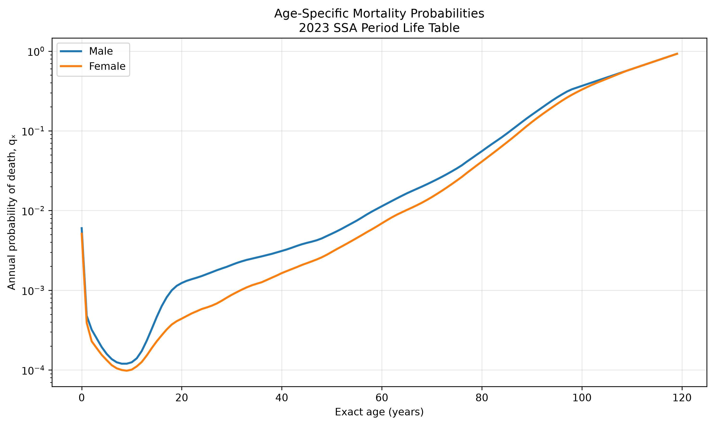
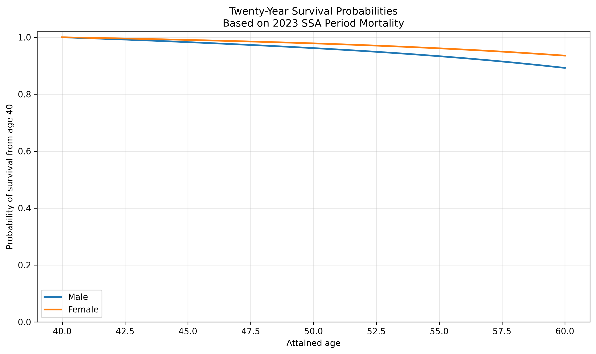
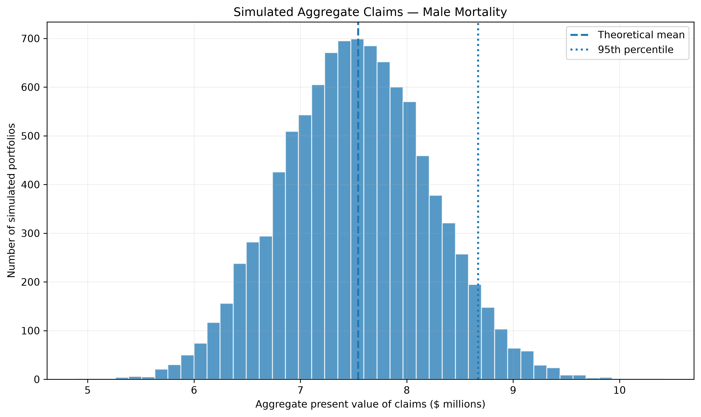
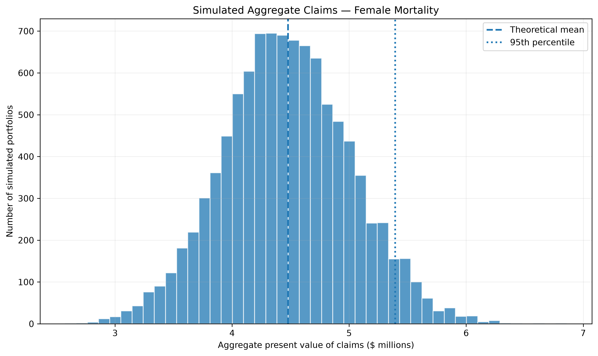

---
title: "Mortality-Driven Term Life Insurance Risk"
subtitle: "A Reproducible Monte Carlo Study Using U.S. Social Security Life Tables"
author: "Bright Antwi"
format:
  html:
    toc: true
    number-sections: true
    embed-resources: true
---

# Introduction

This study investigates how age-specific mortality assumptions influence the expected cost and variability of death-benefit payments in hypothetical term life insurance portfolios. It combines published mortality information, actuarial probability calculations, and Monte Carlo simulation to examine both the average financial obligation and the range of possible aggregate claim outcomes.

## Background and motivation

Term life insurance provides a death benefit when an insured individual dies during a specified coverage period. For an insurer, the financial obligation depends on whether death occurs during that period and, if so, when the benefit becomes payable. Mortality probabilities therefore affect both the likelihood of a claim and its present value. These relationships make mortality assumptions central to actuarial evaluations of life insurance benefits.

Age-specific life tables offer a structured basis for quantifying mortality risk. The annual probability of death generally changes with attained age and may differ between mortality schedules. By combining annual death and survival probabilities across successive policy years, an actuary can calculate the probability that a benefit will be paid during a term and its expected present value. Such calculations provide an analytical benchmark, but an expected value alone does not reveal how widely total claims might vary across otherwise identical portfolios.

Monte Carlo simulation complements these calculations by generating many possible realizations of policyholder deaths under a specified probability model. The resulting distribution of aggregate discounted death benefits can be examined using its mean, standard deviation, relative variability, and upper-tail percentiles. Comparing simulated results with theoretical calculations also offers a way to assess numerical consistency.

This project uses the 2023 period life table published by the U.S. Social Security Administration (SSA), Office of the Chief Actuary, to investigate mortality-driven claims risk under separate male and female mortality schedules. Because the SSA table describes population mortality rather than the experience of an underwritten insurance portfolio, the study is designed as a controlled actuarial illustration rather than a forecast of actual insurer claims or a calculation of commercial premiums.

## Research question

The central research question is:

**Under the specified term life insurance assumptions, how do the male and female age-specific mortality schedules in the 2023 SSA period life table affect expected aggregate discounted death-benefit payments, portfolio variability, and upper-tail claims risk?**

To address this question, the analysis considers two hypothetical portfolios that are identical except for the mortality schedule applied. Each portfolio consists of 1,000 independent, identical policies issued at age 40 for a 20-year term. Each policy provides a $100,000 death benefit payable at the end of the year of death, and benefits are discounted using a constant annual effective interest rate of 3%. The mortality probabilities are held fixed at their 2023 period-table values, and 10,000 portfolio outcomes are simulated for each mortality scenario.

## Project objectives

The overall objective is to develop and apply a reproducible actuarial framework for evaluating how alternative mortality schedules affect the distribution of discounted death-benefit claims under otherwise identical term life insurance assumptions.

The specific objectives are to:

1. **Prepare and validate mortality data** from the published SSA life table, producing an analysis-ready dataset of age-specific male and female mortality probabilities.
2. **Describe mortality and survival patterns** across age and compare cumulative survival and death probabilities over the 20-year term beginning at age 40.
3. **Calculate actuarial benefit values**, including the probability of death during the term, the expected present value of a death benefit per policy, and theoretical aggregate claims moments for each portfolio.
4. **Simulate aggregate discounted claims** for 10,000 portfolios of 1,000 independent policies under each mortality schedule.
5. **Compare financial risk measures and validate the simulation** using expected aggregate claims, standard deviations, coefficients of variation, empirical 95th percentiles, and comparisons with theoretical benchmarks.

Together, these objectives connect the mortality assumptions to both expected death-benefit costs and the variability of possible portfolio outcomes. The analysis focuses on claims under a simplified probability model; it does not attempt to estimate future mortality improvements, incorporate all features of commercial insurance contracts, or determine market premiums.

# Data Source and Description

## Source and provenance
The mortality data used in this study were obtained from the **Social Security Administration (SSA), Office of the Chief Actuary (OACT)**, through its publicly available *Actuarial Life Table*. Specifically, the analysis uses the **2023 period life table for the Social Security area population, as presented in the 2026 Social Security Trustees Report**. The SSA is a U.S. federal agency that publishes demographic and actuarial information used in evaluating the financial sustainability of the Social Security system.

The published life table provides mortality information separately for males and females at single-year ages from 0 through 119. For each age and sex, the table reports the probability of dying within one year ($q_x$), the number of survivors ($l_x$) from a hypothetical initial cohort of 100,000 births, and the remaining life expectancy ($e_x$). These quantities provide a basis for examining mortality patterns, calculating survival and death probabilities, and evaluating hypothetical life insurance benefits.

The source is a **period life table**, meaning that it describes mortality conditions for a particular calendar year rather than following an actual birth cohort throughout its lifetime. Consequently, the 2023 mortality probabilities are treated as fixed assumptions throughout the hypothetical 20-year insurance term considered in this study. The data describe the Social Security area population and do not represent the mortality experience of an individually underwritten life insurance portfolio.

For transparency and reproducibility, an HTML snapshot of the original SSA table was downloaded from the official website and preserved as `data/raw/ssa_life_table_2023.html`. The original file is retained separately from the processed dataset. A documented Python cleaning procedure extracts the mortality observations, restructures the table, and validates the resulting data before saving the analysis-ready file as `data/processed/ssa_mortality_clean.csv`. This separation allows the data-processing workflow to be reproduced without modifying the original source.

The original mortality data are publicly available through the [Social Security Administration's Actuarial Life Table](https://www.ssa.gov/oact/STATS/table4c6.html). The complete source citation is provided in the References section.

## Variables and unit of observation
The original SSA mortality table contains age-specific mortality information separately for males and females. Following data cleaning and restructuring, the dataset was organized in long format, with five variables: `age`, `sex`, `qx`, `lx`, and `ex`.

The cleaned dataset contains **240 observations and five variables**, representing 120 single-year ages (0–119) for each of the two sex-specific mortality schedules. Table 1 provides the definitions and actuarial interpretations of the variables.

**Table 1: Description of variables in the cleaned mortality dataset**

| Variable | Data type | Description | Role in the analysis |
|---|---|---|---|
| `age` | Integer | Exact age, ranging from 0 to 119 years. | Identifies the age at which mortality probabilities are evaluated. |
| `sex` | Categorical | Mortality schedule classification: Male or Female. | Distinguishes the two mortality scenarios considered in the analysis. |
| `qx` | Numeric (probability) | Conditional probability that an individual aged exactly \(x\) dies before reaching age \(x+1\). | Primary input for survival calculations, expected present values, and Monte Carlo simulations. |
| `lx` | Numeric (survivor count) | Number of individuals surviving to exact age \(x\) from a hypothetical initial cohort of 100,000 births. | Provides supporting information for interpreting and validating life-table mortality patterns. |
| `ex` | Numeric (years) | Expected remaining lifetime at exact age \(x\), under the period mortality schedule. | Provides descriptive context for the mortality experience represented in the table. |

### Unit of Observation

The **unit of observation is an age–sex combination**, rather than an individual person, insurance policy, or observed death. For example, the record corresponding to a 40-year-old male contains the mortality probability, hypothetical survivor count, and remaining life expectancy associated with age 40 under the male mortality schedule.

Consequently, the 240 observations should not be interpreted as a sample of 240 independently observed individuals. Instead, they constitute a structured set of published actuarial mortality quantities. The survivor counts (`lx`) are derived from hypothetical life-table cohorts and do not represent the actual number of individuals observed or insured at each age.

### Variables Used in the Actuarial Analysis

Although all five variables are retained in the cleaned dataset, the principal inputs for the actuarial calculations are **`age`, `sex`, and `qx`**. The analysis considers hypothetical 20-year term life insurance policies issued at age 40. Therefore, mortality probabilities for ages **40 through 59**, inclusive, are used to calculate annual survival and death probabilities over the policy term.

For each mortality schedule, the annual death probabilities are combined to determine the probability of death during the 20-year term and the expected present value of a death benefit payable at the end of the year of death.

The variables `lx` and `ex` are retained to preserve important life-table information and provide context for the mortality assumptions, although they are not directly required in the expected present value or simulation calculations.

### Distinction Between Observed Data and Simulated Portfolios

An important distinction is made between the published mortality data and the hypothetical insurance portfolios constructed for the simulation.

The mortality table provides the age-specific probabilities used as model inputs. The Monte Carlo analysis then applies these probabilities to hypothetical portfolios of **1,000 independent, identical term life insurance policies**, evaluated separately under the male and female mortality schedules.

For each schedule, 10,000 portfolio outcomes are simulated to examine the variability of aggregate discounted death-benefit payments.

Thus, the simulated policyholders and insurance claims are **not actual observations from the SSA dataset**. They are generated outcomes under explicitly stated actuarial assumptions, with the SSA mortality probabilities treated as fixed inputs.

## Data limitations
Although the Social Security Administration (SSA) provides an authoritative source of mortality information, several limitations must be considered when interpreting the results of this study.

**Population mortality versus insured-life mortality.** The SSA period life table describes mortality experience for the Social Security area population rather than a portfolio of individually underwritten life insurance policyholders. Individuals purchasing life insurance may differ from the general population in health status, socioeconomic characteristics, and underwriting selection. Consequently, the published mortality probabilities may not accurately represent the mortality experience of a commercial life insurer. The analysis is therefore intended to illustrate actuarial risk measurement rather than determine premiums for an actual insurance portfolio.

**Period mortality and the absence of future mortality projections.** The dataset represents mortality conditions in 2023. Because it is a period life table, it does not track a single birth cohort over time or directly incorporate changes in mortality that may occur in subsequent years. In this study, the published age-specific probabilities are applied throughout the hypothetical 20-year insurance term. This assumes that the 2023 mortality schedule remains unchanged as the insured population ages. Future improvements or deteriorations in mortality could therefore produce outcomes that differ from those obtained under the model.

**Limited policyholder characteristics.** The published table provides mortality quantities by age and sex but does not contain individual-level information on smoking status, occupation, medical history, socioeconomic characteristics, or other variables commonly considered in mortality risk assessment. As a result, the analysis cannot investigate mortality differences associated with these characteristics or perform detailed underwriting-based risk classification. Comparisons between the male and female mortality schedules reflect differences in the published assumptions and should not be interpreted as causal effects.

**Aggregated life-table information and limited estimation uncertainty.** The dataset contains published mortality probabilities and derived life-table quantities rather than individual death records or policyholder-level exposure observations. It therefore does not provide sufficient information to directly estimate sampling uncertainty in the mortality rates using the methods applied in this study. The mortality probabilities are treated as fixed model inputs, and the Monte Carlo simulation examines variation in hypothetical death-benefit payments conditional on those inputs. Consequently, the simulation results do not capture uncertainty arising from the estimation of mortality probabilities themselves.

**Precision and scope of the published data.** The mortality rates, survivor counts, and life expectancies are presented at the precision published by the SSA. In particular, the hypothetical survivor counts are rounded, which can produce zero reported survivors at extremely advanced ages even when the corresponding mortality probabilities remain below one. These rounding effects should be considered when interpreting the full life table. However, the primary insurance analysis uses mortality probabilities for ages 40 through 59, for which the required values are available.

Taken together, these limitations define the scope of the study. The SSA mortality table provides a credible foundation for demonstrating survival calculations, expected present values, and mortality-driven Monte Carlo simulation. Nevertheless, the resulting figures represent outcomes under specified hypothetical assumptions and should not be interpreted as observed insurance claims, forecasts of actual insurer liabilities, or commercially applicable premium estimates.

# Data Preparation and Validation
## Cleaning workflow
The mortality data were prepared for analysis using a reproducible Python workflow. The objective of this stage was to transform the original SSA life table, provided in HTML format, into a structured dataset suitable for mortality analysis, actuarial calculations, and Monte Carlo simulation.

The original HTML file was retained in `data/raw/ssa_life_table_2023.html`, while the data-processing operations were implemented through the reusable `load_clean_mortality()` function in `src/data.py`. Separating the source data from the processing code helps preserve the original observations and makes it possible to repeat the analysis consistently.

The preprocessing workflow imports the mortality information from the locally stored SSA table and organizes the relevant quantities into a long-format dataset. Each observation is identified by an exact age and a sex-specific mortality schedule. The resulting dataset contains five variables: `age`, `sex`, `qx`, `lx`, and `ex`, whose definitions were provided in Section 2.2.

The cleaned dataset is loaded into Python as the DataFrame `mortality`, which serves as the common input for the exploratory analysis, actuarial calculations, and subsequent simulation procedures.

**Cleaned mortality data (first five observations)**


The cleaning procedure produced a dataset containing **240 observations and five variables**. These observations correspond to the two sex-specific mortality schedules across the 120 single-year ages from 0 to 119.

The cleaning function reported that one row was excluded during preprocessing because its age entry could not be converted to a numeric value. According to the processing logic, this row corresponds to the explanatory footnote at the end of the original SSA table rather than an age-specific mortality observation. Its exclusion is therefore intentional and does not affect the mortality records used in the analysis.

After removing the non-data row, the 120 retained age records were reorganized from the original wide format into 240 observations, consisting of one male and one female record for each age from 0 to 119.

The displayed observations confirm that the dataset is arranged in long format, with separate records for males and females at each age. This arrangement allows mortality probabilities to be selected by age and sex without repeatedly restructuring the original life table.

Before using the cleaned probabilities in the actuarial model, additional checks are required to verify that the dataset is complete, contains no duplicate age–sex combinations, and satisfies basic numerical constraints.

## Data quality assessment
Data quality assessment was performed to evaluate the structural completeness and numerical consistency of the cleaned mortality dataset before its use in actuarial calculations.

Unlike an individual-level dataset, the SSA life table contains a defined set of age-specific mortality quantities. The expected structure therefore provides a useful benchmark for checking completeness. In particular, the cleaned data should contain exactly one observation for every age from 0 to 119 under each of the male and female mortality schedules.

The assessment considers several dimensions of data quality:

1. **Structural completeness:** Whether the dataset contains all 240 expected age–sex combinations.
2. **Uniqueness:** Whether each age–sex combination appears exactly once.
3. **Missing values:** Whether any of the five required variables contain missing observations.
4. **Probability validity:** Whether all annual death probabilities satisfy $0 \leq q_x \leq 1$.
5. **Life-table consistency:** Whether survivor counts and remaining life expectancies are nonnegative, the initial survivor count is 100,000, and survivor counts do not increase with age.

These conditions are particularly important because the actuarial model constructs survival probabilities from products of annual survival factors, $1-q_x$. Missing, duplicated, or invalid mortality probabilities could therefore distort the calculated term death probabilities and the distribution used for the Monte Carlo simulation.

**Results of the data-quality checks**


The computational checks confirmed that the cleaned mortality dataset satisfied the specified structural and numerical validation criteria. All 240 expected age–sex combinations were present, with no duplicated records or missing values in the required variables. The annual death probabilities were within the interval $[0,1]$, while the survivor counts and remaining life expectancies satisfied the imposed nonnegativity requirements. The survivor series also began at 100,000 for each sex and did not increase with age.

These findings indicate that the cleaned data are internally consistent with the structure required for the actuarial calculations. In particular, the completeness of the age–sex combinations ensures that the mortality probabilities for ages 40 through 59 can be retrieved without gaps.

Nevertheless, these checks establish structural and numerical consistency rather than external predictive accuracy. They do not determine whether the SSA period mortality rates accurately represent future insured mortality or the experience of an underwritten commercial insurance portfolio. Those limitations are considered separately in the discussion of the model assumptions.

# Exploratory Data Analysis
Exploratory data analysis was conducted to examine the age-specific structure of mortality and identify differences between the male and female mortality schedules before constructing the term life insurance model. Particular attention was given to the relationship between age and the annual probability of death, as well as the implications of these patterns for survival over a fixed insurance term.

The analysis begins with descriptive summaries of the cleaned SSA mortality dataset, followed by a graphical comparison of mortality probabilities across ages. Finally, survival probabilities are calculated over a 20-year period for an individual entering the insurance contract at age 40. These analyses provide the descriptive foundation for the actuarial calculations developed in Section 5.

**Descriptive summary of the SSA mortality schedules**



**Age-specific probabilities at selected ages**


The descriptive summary confirms that each mortality schedule contains 120 observations, covering exact ages 0 through 119. The average age-specific mortality probability across these ages is approximately 0.135420 for males and 0.126751 for females.

These averages should be interpreted cautiously because they are unweighted summaries of mortality probabilities across ages rather than population-level annual death probabilities. In particular, the inclusion of extremely old ages, at which annual mortality probabilities are substantially higher, influences the overall averages. Consequently, the selected-age comparisons and graphical mortality patterns provide more meaningful information for the proposed insurance application.

The selected-age mortality table reveals clear differences in death probabilities across age and sex. At age 20, the annual probability of death is approximately 0.001235 for males and 0.000441 for females. At age 40, these probabilities increase to 0.003115 and 0.001643, respectively. By age 60, they increase further to 0.011337 for males and 0.006923 for females.

Male mortality exceeds female mortality at every age included in the selected-age summary. The results also demonstrate that mortality risk changes considerably over an individual's lifetime.

For the term life insurance model, the most relevant observations are those between ages 40 and 59, corresponding to the 20 policy years of the hypothetical contract. The observed age variation and differences between the two mortality schedules motivate the use of age-specific annual death probabilities rather than a constant mortality assumption.

## Age-specific mortality patterns
To examine the mortality patterns more comprehensively, annual death probabilities were plotted against exact age for the male and female mortality schedules.

A logarithmic scale was used on the vertical axis because annual death probabilities vary by several orders of magnitude across the age range. This representation makes it possible to examine mortality differences at younger ages while retaining visibility of the substantially higher death probabilities observed at advanced ages. Equal vertical distances on this scale represent equal multiplicative changes rather than equal absolute changes in mortality probability.

{#fig-age-mortality}

The figure displays a characteristic age-related mortality pattern for both sexes. Annual death probabilities are relatively high at birth, decline sharply during early childhood, and reach their lowest levels during childhood. Mortality probabilities subsequently rise through adolescence and early adulthood, followed by a sustained increase across middle and older ages.

The increase in mortality during adolescence and early adulthood is more pronounced for males. Across most of the observed age range, the male mortality curve lies above the female curve, indicating higher annual probabilities of death for males under the SSA mortality schedules. At the most advanced ages, the two curves approach one another.

The pattern is particularly relevant during the ages covered by the proposed insurance contract. Between ages 40 and 59, annual mortality probabilities increase with attained age for both sexes, while male mortality remains higher than female mortality.

These findings have two direct actuarial implications. First, the probability of a death benefit becoming payable depends on the policyholder's attained age and therefore changes throughout the coverage period. Second, differences between the male and female mortality schedules are expected to produce differences in the timing and frequency of death benefit payments.

Accordingly, the actuarial model uses the age-specific mortality probabilities associated with each policy year rather than assuming a uniform probability of death throughout the term.

## Survival probabilities
Although annual mortality probabilities describe the risk of death over individual one-year intervals, term life insurance requires consideration of survival over multiple consecutive years.

For this reason, the annual SSA mortality probabilities were combined to calculate cumulative survival probabilities from age 40 through age 60. Survival at age 40 was initialized at one, and subsequent survival probabilities were obtained by multiplying the successive annual survival factors, $1-q_x$, for ages 40 through 59.

Separate survival curves were constructed for males and females to examine how differences in annual mortality accumulate over the 20-year coverage period.

**Twenty-year survival and death probabilities from age 40**



{#fig-term-survival}

The figure shows that survival probabilities decrease with attained age for both mortality schedules. The decline occurs because each additional policy year introduces another possibility of death, reducing the probability of surviving from the original entry age.

Throughout the coverage period, the female survival curve remains above the male survival curve. This reflects the lower annual mortality probabilities associated with the female schedule over the ages considered.

At the end of the 20-year term, the calculated survival probability is approximately 0.892496 for males and 0.935602 for females. Expressed as percentages, these correspond to **89.2496%** and **93.5602%**, respectively.

The difference in survival probabilities is approximately **4.3106 percentage points** in favor of females.

The complementary probabilities of dying before the end of the term are therefore **10.7504% for males** and **6.4398% for females**. Under the specified mortality assumptions, the male probability of death during the 20-year term is approximately 1.67 times the corresponding female probability.

These findings demonstrate how differences in annual mortality probabilities accumulate over multiple policy years, producing meaningful differences in the likelihood of a death benefit payment.

Importantly, the calculations use the age-specific rates from the 2023 SSA period life table throughout the hypothetical coverage period. They therefore represent survival under the assumed fixed period mortality schedule rather than a forecast incorporating future improvements in mortality.

The resulting survival and term death probabilities provide the foundation for the actuarial framework in Section 5, where the timing of death benefits and the time value of money are incorporated into expected present value calculations.

# Actuarial Framework

## Term life insurance assumptions
This study considers a hypothetical 20-year term life insurance contract to evaluate the financial implications of mortality risk under the published SSA mortality schedules. Term life insurance provides a specified death benefit if the insured dies within the coverage period. No death benefit is payable if the insured survives beyond the policy term.

The analysis examines two separate insurance scenarios based on the male and female mortality schedules. All contractual and financial assumptions are held constant across the scenarios to isolate differences attributable to the underlying mortality probabilities.

### Policy and Financial Assumptions

The contract is assumed to be issued to an individual aged exactly 40, with coverage extending for 20 years, until the individual reaches age 60. A death occurring during the coverage period triggers a benefit of $100,000, payable at the end of the policy year in which death occurs.

Future death benefits are discounted using a fixed annual effective interest rate of 3%. Thus, a benefit payable at the end of policy year $t$ has a present value of

$$
PV_t=Bv^t=\frac{B}{(1+i)^t},
$$

where $B=\$100{,}000$ is the death benefit, $i=0.03$ is the annual effective interest rate, and $v=(1+i)^{-1}$ is the annual discount factor.

**Table: Summary of Term Life Insurance Assumptions**

| Parameter | Assumption |
|---|---|
| Insurance product | Term life insurance |
| Age at policy inception | 40 years |
| Policy duration | 20 years |
| Coverage period | From exact age 40 to exact age 60 |
| Death benefit | $100,000 per policy |
| Benefit payment timing | End of the policy year of death |
| Annual effective interest rate | 3% |
| Mortality basis | SSA 2023 period life table |
| Mortality schedules | Male and female, analyzed separately |
| Mortality projection | No future mortality improvement or deterioration assumed |
| Portfolio size | 1,000 identical policies per scenario |
| Dependence assumption | Independent policyholder mortality outcomes |
| Simulation replications | 10,000 portfolios per mortality scenario |

### Mortality Assumptions

Annual mortality probabilities are obtained from the SSA 2023 period life table. Specifically, the probabilities $q_{40},q_{41},\ldots,q_{59}$ are used to represent mortality during the 20 policy years.

For each mortality schedule, $q_x$ denotes the conditional probability that an individual aged exactly $x$ dies before reaching age $x+1$. The corresponding one-year survival probability is

$$
p_x=1-q_x.
$$

The published age-specific mortality rates are assumed to remain unchanged throughout the projection period. Accordingly, the model applies the 2023 period mortality schedule to each attained age without incorporating future mortality trends or cohort effects.

Separate calculations are performed using the male and female mortality schedules. All other policy characteristics are identical between the two scenarios, allowing the resulting differences in expected benefits and aggregate claims to be attributed to the mortality assumptions.

### Portfolio and Simulation Assumptions

To investigate aggregate mortality risk, the analysis considers hypothetical portfolios consisting of 1,000 identical term life insurance policies. Each policyholder is assumed to be aged exactly 40 at inception and subject to the same mortality schedule within a given scenario.

Policyholder deaths are assumed to occur independently. Consequently, the death or survival outcome of one insured individual does not affect the mortality outcome of another. This assumption permits the aggregate number of policyholders experiencing death in each policy year to be modeled using a multinomial distribution.

For each mortality scenario, 10,000 hypothetical portfolio outcomes are generated through Monte Carlo simulation. In each simulated portfolio, death-benefit payments are determined by the simulated policyholder outcomes, discounted to policy inception, and aggregated to obtain the total present value of claims.

The simulation therefore describes the distribution of aggregate discounted death-benefit payments conditional on the specified mortality and financial assumptions.

### Simplifying Assumptions

To maintain a clearly defined computational framework, several features of actual life insurance contracts are excluded.

The study assumes no policy lapses, surrenders, or changes in coverage during the 20-year term. The death benefit remains fixed at $100,000, and the annual effective interest rate remains constant at 3%.

The analysis does not incorporate premium payments, operating expenses, commissions, profit margins, investment return uncertainty, or policyholder-specific underwriting adjustments. Furthermore, mortality probabilities are treated as known and fixed, rather than estimated with uncertainty.

Consequently, the expected present values calculated in this study represent the **actuarial present value of death benefits under the specified assumptions**, rather than commercial insurance premiums. Similarly, the simulated aggregate claims represent hypothetical mortality-driven insurance payments and should not be interpreted as actual insurer liabilities, regulatory capital requirements, or observed insurance claims.

These assumptions provide a controlled framework for comparing mortality scenarios and examining the relationship between expected claims, portfolio variability, and adverse claim outcomes.

## Probability of death during the term
The probability of death during the policy term is a fundamental component of term life insurance risk assessment. While the SSA mortality table provides the probability of death within a single year of age, evaluating a multi-year insurance contract requires combining these probabilities across the entire coverage period.

Let $q_x$ denote the conditional probability that an individual aged exactly $x$ dies before reaching age $x+1$. The corresponding one-year survival probability is

$$
p_x=1-q_x.
$$

For an individual aged $x$, the probability of surviving $t$ complete years is denoted by ${}_tp_x$ and calculated as

$$
\boxed{
{}_tp_x=\prod_{j=0}^{t-1}(1-q_{x+j}).
}
$$

This expression accounts for the requirement that the individual must survive each preceding year to remain exposed to mortality risk in subsequent years.

In this study, the policyholder is assumed to be aged exactly 40 at policy inception, with a coverage period of 20 years. Consequently, the probability of surviving the entire term is

$$
\boxed{
{}_{20}p_{40}=\prod_{j=0}^{19}(1-q_{40+j}).
}
$$

The probability of dying at some point during the 20-year term is therefore

$$
\boxed{
{}_{20}q_{40}=1-{}_{20}p_{40}.
}
$$

### Probability of Death in Each Policy Year

In addition to the overall probability of death during the term, the analysis calculates the probability that death occurs within each specific policy year.

For death to occur during policy year $t$, the insured must survive the preceding $t-1$ years and then die during the following year. The corresponding unconditional probability is

$$
\boxed{
d_t={}_{t-1}p_{40}\,q_{40+t-1},
\qquad t=1,2,\ldots,20.
}
$$

Here, $d_t$ represents the probability, measured at policy inception, of death during policy year $t$.

For example, the probability of death during the first policy year is

$$
d_1=q_{40},
$$

while the probability of death during the second policy year is

$$
d_2=(1-q_{40})q_{41}.
$$

Similarly, the probability of death during the twentieth policy year is

$$
d_{20}={}_{19}p_{40}q_{59}.
$$

These probabilities are unconditional because they incorporate the probability of surviving to the beginning of the relevant policy year. This distinguishes them from the published annual mortality probabilities, $q_x$, which are conditional on being alive at exact age $x$.

Together, the probabilities of death during the 20 policy years and the probability of surviving the entire term form a complete probability distribution:

$$
\boxed{
\sum_{t=1}^{20}d_t+{}_{20}p_{40}=1.
}
$$

This identity provides an important numerical validation check for the subsequent Monte Carlo simulation.

### Computational Implementation

The calculations were implemented in Python using the reusable function `term_death_probabilities()` in `src/life_math.py`. For each mortality schedule, the function extracts the published mortality probabilities for ages 40 through 59, calculates survival probabilities at the beginning of each policy year, and determines the unconditional probability of death during each year.

The function also calculates the probability of surviving the entire policy term and verifies that the resulting outcome probabilities sum to one, subject to numerical precision. Separate calculations are performed for the male and female mortality schedules.

### Results and Interpretation

The calculated 20-year survival and death probabilities are presented in the following table.

**20-year survival and death probabilities**


Under the SSA 2023 period mortality assumptions, an individual aged 40 has an estimated 10.7504% probability of dying before reaching age 60 under the male mortality schedule, compared with 6.4398% under the female schedule.

The male schedule therefore produces a **4.3106 percentage-point higher probability of death** over the 20-year term.

This difference reflects the accumulation of age-specific mortality probabilities throughout the coverage period. It is consistent with the exploratory survival curves, which show a higher probability of survival under the female mortality schedule across the modeled ages.

From an actuarial perspective, the probability of death during the term helps quantify the likelihood that an insurer will become obligated to pay the death benefit. However, it does not by itself determine the expected present value of the insurance contract, because the timing of death also affects the value of the payment through discounting.

For this reason, the unconditional death-year probabilities, $d_t$, are subsequently used to calculate the expected present value of the death benefit and to construct the probability distribution for Monte Carlo simulation.

These results are conditional on the published SSA mortality assumptions and should not be interpreted as observed death rates for a portfolio of underwritten life insurance policyholders.

## Expected present value of death benefits
The expected present value (EPV) of death benefits represents the probability-weighted average of future insurance payments, discounted to the beginning of the policy term. Unlike the probability of death during the term, which measures the likelihood of a claim occurring, the EPV incorporates both the probability and timing of death, as well as the financial value of the promised benefit.

For the 20-year term life insurance contract considered in this study, a death benefit of $100,000 is payable at the end of the policy year in which death occurs. No death benefit is payable if the insured survives beyond the policy term.

### Mathematical Formulation

Let $Z$ denote the present value of the death benefit for an individual policy. The random variable $Z$ is defined as

$$
Z=
\begin{cases}
Bv^t, & \text{if death occurs during policy year }t,\\[4pt]
0, & \text{if the insured survives the 20-year term},
\end{cases}
$$

where:

- $B=\$100{,}000$ is the fixed death benefit;
- $v=(1+i)^{-1}$ is the annual discount factor;
- $i=0.03$ is the annual effective interest rate;
- $t=1,2,\ldots,20$ represents the policy year of death.

As established in the preceding subsection, the unconditional probability of death during policy year $t$ is

$$
d_t={}_{t-1}p_{40}q_{40+t-1}.
$$

The expected present value of the death benefit is therefore

$$
\boxed{
E[Z]
=
B\sum_{t=1}^{20}
v^t\,{}_{t-1}p_{40}q_{40+t-1}.
}
$$

Equivalently, using the previously defined death-year probabilities,

$$
E[Z]
=
B\sum_{t=1}^{20}v^td_t.
$$

Substituting the contractual and financial assumptions gives

$$
\boxed{
E[Z]
=
100{,}000
\sum_{t=1}^{20}
(1.03)^{-t}
\,{}_{t-1}p_{40}q_{40+t-1}.
}
$$

Each term in the summation represents the discounted death benefit multiplied by the probability that the corresponding payment occurs. Because the death benefit is payable only upon death within the coverage period, the outcome of survival beyond the term contributes zero to the expected benefit.

### Computational Implementation

The EPV calculations were implemented in Python using the reusable function `term_epv()` in `src/life_math.py`.

For each mortality schedule, the function receives the unconditional death-year probabilities generated by `term_death_probabilities()`. It then calculates the present value of the $100,000 benefit for each possible policy year of death and forms the probability-weighted sum of those discounted payments.

The same contractual assumptions are applied independently to the male and female mortality schedules. This ensures that any difference in the resulting EPVs is attributable to differences in the underlying mortality assumptions rather than differences in benefit amounts, coverage periods, or discount rates.

### Results and Interpretation

The expected present values obtained from the SSA 2023 period mortality schedules are summarized below.

**Actuarial expected present values by mortality schedule**


Under the specified mortality assumptions, the expected discounted death-benefit payment for a 20-year term life insurance policy issued at age 40 is approximately **$7,541.96 under the male mortality schedule**, compared with **$4,478.56 under the female mortality schedule**.

The male mortality schedule therefore produces an expected present value approximately **$3,063.40 higher**, representing an increase of approximately **68.4% relative to the female schedule**.

Because the contractual and financial assumptions are identical, this difference arises from the age-specific mortality probabilities and the resulting distribution of death-benefit payments across the policy term.

The results are consistent with the previously calculated 20-year death probabilities, which were higher under the male mortality schedule. However, the relative difference between the EPVs is not necessarily equal to the relative difference between the probabilities of death. This is because the EPV also reflects when deaths are expected to occur.

A death benefit payable earlier in the contract has a higher present value than the same benefit payable later, owing to discounting. Consequently, mortality timing influences the expected financial cost of the policy in addition to the overall probability of death.

### Extension to a Portfolio of Policies

For a portfolio of $N$ independent, identically distributed policies with individual present values $Z_1,Z_2,\ldots,Z_N$, aggregate discounted claims are defined as

$$
S_N=\sum_{j=1}^{N}Z_j.
$$

By the linearity of expectation,

$$
E[S_N]=\sum_{j=1}^{N}E[Z_j].
$$

Since the hypothetical portfolio contains 1,000 identical policies under each mortality schedule,

$$
\boxed{
E[S_N]=N E[Z]=1{,}000E[Z].
}
$$

The resulting theoretical expected aggregate present values are approximately $7.54 million under the male mortality schedule and $4.48 million under the female mortality schedule.

These quantities provide analytical benchmarks for the subsequent Monte Carlo simulations, which investigate how actual aggregate discounted claims could vary across hypothetical portfolios.

### Actuarial Implications

The EPV provides a fundamental measure of the expected cost of insurance benefits under specified mortality and financial assumptions. It is an important component of life insurance valuation and pricing analysis because it combines the probability of insured events with the timing and amount of the resulting payments.

Nevertheless, the EPV represents an expected discounted benefit rather than a commercial insurance premium. Actual premium determination would require additional consideration of expenses, policyholder behavior, underwriting characteristics, profit provisions, and other relevant assumptions.

Furthermore, an expected value alone does not describe the variability of possible insurance outcomes. Two portfolios may have the same expected aggregate claims but different levels of uncertainty or exposure to unusually high losses.

For this reason, the next stage of the analysis uses Monte Carlo simulation to investigate the distribution of aggregate discounted death benefits and assess mortality-driven portfolio risk beyond the expected value.

# Monte Carlo Simulation

## Simulation methodology
The expected present value of an insurance contract provides a measure of its average discounted benefit cost under specified assumptions. However, the expected value alone does not describe the variability of claims that an insurer may experience. Even when mortality probabilities are known and fixed, the actual number and timing of deaths within an insurance portfolio are uncertain.

To investigate this uncertainty, a **Monte Carlo simulation** was conducted to estimate the distribution of aggregate discounted death-benefit payments for hypothetical term life insurance portfolios. Monte Carlo simulation is a computational method that uses repeated random sampling from a specified probability distribution to investigate the behavior of quantities that depend on uncertain outcomes.

The simulation was conducted separately under the male and female SSA 2023 mortality schedules, using identical contractual and financial assumptions. This allows differences in the simulated claim distributions to be examined under the two sets of mortality probabilities.

### Simulation Design

Each simulated portfolio consists of 1,000 independent, identical 20-year term life insurance policies issued at age 40. Each policy provides a $100,000 death benefit payable at the end of the policy year of death, with future payments discounted at an annual effective interest rate of 3%.

For each mortality schedule, **10,000 independent portfolio outcomes** were generated. Each simulated outcome represents one possible realization of aggregate claims over the entire 20-year coverage period.

The number of simulation replications was selected to provide a reasonably precise numerical assessment of the mean and variability of aggregate claims while maintaining computational efficiency. Increasing the number of replications generally reduces Monte Carlo error, with the standard error of the simulated mean decreasing at a rate proportional to the inverse square root of the number of replications.

### Construction of the Outcome Distribution

For an individual term life insurance policy, there are 21 mutually exclusive and collectively exhaustive outcomes:

- Death during one of the 20 policy years.
- Survival throughout the 20-year policy term.

As established in the actuarial framework, the unconditional probability of death during policy year $t$ is

$$
d_t={}_{t-1}p_{40}q_{40+t-1},
\qquad t=1,2,\ldots,20.
$$

The probability of surviving the entire term is

$$
s={}_{20}p_{40}.
$$

The complete probability vector is therefore

$$
\boldsymbol{\pi}
=
(d_1,d_2,\ldots,d_{20},s),
$$

where

$$
\sum_{t=1}^{20}d_t+s=1.
$$

This distribution fully describes the possible mortality outcomes for an individual policy under the selected mortality schedule.

### Multinomial Simulation of Portfolio Mortality

Because all policies within a portfolio are assumed to have identical mortality probabilities and independent outcomes, the numbers of policyholders assigned to the 21 possible outcome categories can be simulated using a multinomial distribution.

Let $N_t$ denote the number of policyholders dying during policy year $t$, for $t=1,\ldots,20$, and let $N_{21}$ denote the number surviving the full term.

For a portfolio of $N=1{,}000$ policies,

$$
\boxed{
(N_1,N_2,\ldots,N_{20},N_{21})
\sim
\operatorname{Multinomial}
\left(1{,}000;\,d_1,d_2,\ldots,d_{20},s\right).
}
$$

For every simulated portfolio, the multinomial draw assigns all 1,000 policyholders to exactly one outcome category. Therefore,

$$
\sum_{t=1}^{21}N_t=1{,}000.
$$

The multinomial approach is computationally efficient because it simulates the number of deaths in each policy year directly, rather than separately generating a death-year outcome for every policyholder.

### Calculation of Aggregate Discounted Claims

For each simulated portfolio, the number of deaths during each policy year is multiplied by the present value of the corresponding death benefit.

Let $S_N$ denote the aggregate present value of death-benefit payments for a portfolio of $N$ policies. The aggregate discounted claims are calculated as

$$
\boxed{
S_N
=
B\sum_{t=1}^{20}N_t(1+i)^{-t},
}
$$

where $B=\$100{,}000$, $i=0.03$, and $N_t$ is the simulated number of deaths during policy year $t$.

Policyholders who survive the entire term contribute zero to the aggregate claims because no death benefit is payable upon survival.

The resulting aggregate present value represents one possible financial outcome for the hypothetical insurance portfolio. Repeating this process produces a simulated distribution of aggregate discounted claims.

### Computational Implementation and Reproducibility

The Monte Carlo procedure was implemented in Python using NumPy and the reusable function `simulate_aggregate_claims()` in `src/simulation.py`.

The function receives the unconditional death-year probabilities, the probability of survival throughout the term, the number of policies, the number of simulation replications, the death benefit, the interest rate, and a NumPy random number generator.

The `numpy.random.Generator.multinomial()` method is used to generate policyholder counts across the mortality outcome categories. Discounted benefits are then multiplied by the corresponding death counts and summed to obtain aggregate claims for each simulated portfolio.

To support reproducibility, the random number generator was initialized using a fixed seed of **2026**. This allows the simulated results to be reproduced when the same code, inputs, software environment, and random-number generation procedure are used.

The simulation is performed separately for the male and female mortality schedules, with 10,000 aggregate claim outcomes generated for each scenario.

### Summary Measures of Portfolio Risks

The simulated aggregate claims are summarized using several descriptive and risk-related measures.

**Simulated mean.** The mean of the simulated aggregate claims estimates the expected present value of total portfolio claims. For $M=10{,}000$ simulation replications, the estimator is

$$
\widehat{\mu}_S
=
\frac{1}{M}\sum_{m=1}^{M}S_N^{(m)},
$$

where $S_N^{(m)}$ represents aggregate discounted claims from simulated portfolio $m$.

**Simulation standard deviation.** The sample standard deviation measures the variability in aggregate claims across simulated portfolios. A larger standard deviation indicates greater absolute dispersion around the expected claims amount.

**Monte Carlo standard error.** The numerical uncertainty associated with the simulated mean is estimated as

$$
\widehat{\operatorname{MCSE}}
=
\frac{\widehat{\sigma}_S}{\sqrt{M}},
$$

where $\widehat{\sigma}_S$ is the sample standard deviation of the simulated aggregate claims.

It is important to distinguish the simulation standard deviation from the Monte Carlo standard error. The former describes variation in potential insurance claim outcomes, while the latter describes uncertainty in the numerical estimate of the expected aggregate claims.

**95th percentile of aggregate claims.** The empirical 95th percentile is also calculated to characterize relatively adverse claim outcomes. It represents a threshold that approximately 95% of the simulated aggregate discounted claim amounts do not exceed.

The simulated claim distributions are visualized using histograms, with the theoretical expected aggregate claims and the empirical 95th percentile marked as reference values.

### Interpretation and Scope of the Simulation

The simulation measures **mortality-driven process risk** conditional on the specified life-table probabilities, independent policyholder outcomes, fixed death benefits, and constant interest rate.

It does not incorporate uncertainty in the estimated mortality rates, future mortality improvements or deterioration, dependence arising from common mortality shocks, policy lapses, or fluctuations in investment returns.

The purpose of the simulation is therefore not to forecast the actual claims of an insurance company, but to demonstrate how uncertainty in the number and timing of deaths produces variability in aggregate discounted insurance benefits.

The resulting simulated distributions are subsequently compared with analytical expectations and theoretical standard deviations to evaluate the numerical consistency of the computational approach.

## Simulation results
The Monte Carlo simulation generated 10,000 possible aggregate discounted claim outcomes for each of the two hypothetical insurance portfolios. Each simulated portfolio consisted of 1,000 independent, identical 20-year term life insurance policies, with a death benefit of $100,000 per policy and an annual effective interest rate of 3%.

The simulation results were summarized using the mean, standard deviation, Monte Carlo standard error, and 95th percentile of aggregate discounted claims. These measures provide complementary information about the expected cost, variability, numerical precision, and upper-tail risk associated with each mortality scenario.

### Summary of Simulated Aggregate Claims
**Summary of 10,000 simulated portfolios for each mortality schedule**


### Expected Aggregate Claims

The simulated mean aggregate discounted claims were approximately **$7.52 million under the male mortality schedule** and **$4.47 million under the female mortality schedule**.

The male portfolio therefore had an average simulated claims amount approximately $3.05 million higher than the female portfolio, representing a difference of about 68.3% relative to the female portfolio.

Because both scenarios use the same number of policies, death benefit, policy duration, and discount rate, the difference in average claims reflects the different age-specific mortality probabilities in the two SSA mortality schedules.

The higher simulated mean under the male mortality schedule is consistent with the previously calculated probability of death during the 20-year term. Specifically, the male schedule produced a 20-year death probability of approximately 10.75%, compared with 6.44% under the female schedule.

These results demonstrate how differences in assumed mortality can affect the expected financial obligations associated with a portfolio of life insurance contracts.

### Variability of Aggregate Claims

The simulation standard deviation measures the dispersion of aggregate discounted claims across the 10,000 hypothetical portfolio outcomes.

The male portfolio produced a standard deviation of approximately **$693,675**, compared with **$545,481** for the female portfolio. Thus, the male mortality scenario exhibited greater absolute variability in aggregate claims.

However, comparing standard deviations alone does not fully describe the relative variability of portfolios with substantially different expected claims.

To provide a scale-independent comparison, the coefficient of variation (CV) can be calculated as

$$
CV=\frac{\text{Standard Deviation}}{\text{Mean}}\times100\%.
$$

Using the simulated results, the coefficients of variation are approximately 9.22% for the male portfolio and 12.20% for the female portfolio.

Although the male portfolio has greater absolute claims variability, the female portfolio exhibits greater variability relative to its average claims amount.

This distinction illustrates the importance of considering both absolute and relative measures of financial risk when comparing insurance portfolios with different expected loss levels.

### Upper-Tail Risk: The 95th Percentile

The empirical 95th percentile of aggregate claims provides additional information about potentially adverse portfolio outcomes.

Under the male mortality schedule, the estimated 95th percentile was approximately **$8.67 million**, compared with **$5.39 million** under the female mortality schedule.

These values represent thresholds below which approximately 95% of the simulated aggregate discounted claim outcomes fall. Equivalently, approximately 5% of simulated portfolios produced claims exceeding their respective thresholds.

For the male portfolio, the 95th percentile was approximately $1.15 million, or 15.23%, above the simulated mean. For the female portfolio, it was approximately $921,463, or 20.61%, above the simulated mean.

These findings indicate that aggregate claims can exceed their expected levels by substantial amounts even when mortality probabilities and policy characteristics are held fixed.

The male portfolio exhibits a higher absolute upper-tail claims threshold, whereas the female portfolio has a larger 95th-percentile excess relative to its simulated mean.

The 95th percentile is a descriptive measure of the simulated claim distribution and should not be interpreted as a regulatory capital requirement or a guarantee that claims will remain below the stated threshold.

### Distribution of Simulated Aggregate Claims

The distributions of aggregate discounted claims were examined using separate histograms for the male and female mortality scenarios.

Each histogram displays the frequency of simulated portfolio outcomes across different aggregate claim amounts. The horizontal axis represents the aggregate present value of claims in millions of dollars, while the vertical axis represents the number of simulated portfolios.

Two reference lines are included in each figure: the theoretical expected aggregate claims, indicated by a dashed line, and the empirical 95th percentile, indicated by a dotted line.

**Male Mortality Scenario**

{#fig-claims-male}

The histogram for the male mortality schedule shows a unimodal distribution of simulated aggregate claims, with most outcomes concentrated around the expected claims amount of approximately $7.54 million.

The distribution exhibits an approximately bell-shaped pattern, although individual frequencies fluctuate because the outcomes are generated through random simulation.

The empirical 95th percentile of approximately $8.67 million lies to the right of the expected value, highlighting the possibility of substantially higher claims in relatively adverse mortality outcomes.

The dispersion around the mean demonstrates that, even for a homogeneous portfolio of 1,000 independent policies, the total present value of death benefits is subject to considerable uncertainty.

**Female Mortality Scenario**

{#fig-claims-female}

The histogram for the female mortality schedule also displays a unimodal, approximately bell-shaped distribution, centered around the theoretical expected claims amount of approximately $4.48 million.

Compared with the male portfolio, the female claim distribution is shifted toward lower aggregate claim amounts and exhibits less variability in absolute dollar terms.

The 95th percentile of approximately $5.39 million is nevertheless noticeably above the expected value, demonstrating that the possibility of adverse claim outcomes remains relevant even under the lower-mortality scenario.

The larger coefficient of variation for the female portfolio also indicates that its aggregate claims are more variable relative to their expected level.

### Comparison of Mortality Scenarios

Taken together, the simulated results reveal three important differences between the two mortality scenarios.

First, the male portfolio produces higher average aggregate discounted claims, consistent with the higher mortality probabilities observed under the male SSA life table.

Second, the male portfolio exhibits greater absolute variability in claim amounts, as reflected in its larger simulation standard deviation.

Third, although the female portfolio has lower expected claims and a smaller absolute standard deviation, it exhibits greater relative variability when measured using the coefficient of variation.

These findings illustrate why aggregate mortality risk cannot be adequately described by expected claims alone. The distribution of potential outcomes provides additional information about the magnitude and relative variability of insurance liabilities under the modeled assumptions.

### Monte Carlo Precision and Transition to Numerical Validation

The Monte Carlo standard errors were approximately $6,937 for the male portfolio and $5,455 for the female portfolio. These quantities describe the uncertainty in the simulated estimates of expected aggregate claims arising from the finite number of simulation replications.

They should not be confused with the much larger simulation standard deviations, which describe the actual variability of potential aggregate claims under the assumed mortality model.

Although the simulation provides useful estimates of the expected claims and their distribution, its numerical consistency should be assessed against results calculated directly from the underlying probability model.

The following subsection therefore compares the simulated means and standard deviations with their exact theoretical counterparts. This validation provides an independent assessment of whether the computational procedure reproduces the properties implied by the actuarial assumptions.

## Numerical validation
The Monte Carlo simulation provides estimates of the expected aggregate discounted claims and their variability. However, before interpreting these estimates as measures of portfolio risk, it is important to assess whether the simulation reproduces the theoretical properties implied by the assumed mortality model.

Numerical validation was therefore performed by comparing the simulated means and standard deviations with their analytical counterparts. Since the probabilities of death in each policy year are known under the specified SSA mortality schedules, the theoretical moments of aggregate discounted claims can be calculated directly without simulation.

This comparison provides an independent benchmark for evaluating the numerical behavior of the Monte Carlo procedure.

### Theoretical Mean and Standard Deviation

Let $Z$ denote the present value of the death benefit for an individual term life insurance policy, and let $S_N$ represent aggregate discounted claims for a portfolio of $N$ independent, identically distributed policies.

As established in Section 5, the expected present value of an individual death benefit is

$$
E[Z]=B\sum_{t=1}^{20}v^td_t,
$$

where $B$ is the death benefit, $v=(1+i)^{-1}$ is the annual discount factor, and $d_t$ is the unconditional probability of death during policy year $t$.

To obtain the theoretical variability, the second moment of the discounted benefit is calculated as

$$
E[Z^2]=B^2\sum_{t=1}^{20}v^{2t}d_t.
$$

The variance of the individual policy's present value is therefore

$$
\operatorname{Var}(Z)
=
E[Z^2]-\big(E[Z]\big)^2.
$$

For a portfolio of $N$ independent policies, the theoretical expected aggregate claims and standard deviation are

$$
\boxed{
E[S_N]=NE[Z]
}
$$

and

$$
\boxed{
\operatorname{SD}(S_N)
=
\sqrt{N\operatorname{Var}(Z)}.
}
$$

The standard deviation formula relies on the assumption that individual policy outcomes are independent. Under this assumption, the variances of the individual discounted benefits can be added to obtain the variance of total portfolio claims.

These expressions are evaluated separately using the male and female mortality schedules. They provide exact theoretical benchmarks conditional on the specified mortality probabilities, policy assumptions, and independence structure.

The calculations were implemented through the reusable Python function `portfolio_moments()` in `src/life_math.py`.

### Comparison of Theoretical and Simulated Results

The theoretical aggregate means and standard deviations were compared with the corresponding estimates obtained from 10,000 Monte Carlo portfolio replications for each mortality scenario.

**Comparison of theoretical and simulated portfolio moments**


Under the male mortality schedule, the theoretical expected aggregate discounted claims were approximately **$7,541,956**, while the simulated mean was approximately **$7,524,475**.

The simulated mean was therefore approximately $17,481 below its theoretical counterpart, representing a relative difference of approximately 0.23%.

Under the female mortality schedule, the theoretical expected aggregate claims were approximately **$4,478,555**, compared with a simulated mean of approximately **$4,471,204**. The difference was approximately $7,352, or 0.16% of the theoretical mean.

Both simulated means were slightly lower than their theoretical counterparts. However, the relative differences were small compared with the total expected aggregate claims.

The theoretical and simulated standard deviations also exhibited relatively small differences.

For the male portfolio, the theoretical standard deviation was approximately $698,646, compared with a simulated standard deviation of approximately $693,675. This corresponds to a relative difference of approximately 0.71%.

For the female portfolio, the theoretical standard deviation was approximately $548,194, compared with a simulated standard deviation of approximately $545,481, representing a relative difference of approximately 0.49%.

The simulated standard deviations were therefore close to the values implied by the analytical probability model.

These comparisons suggest that the simulation reproduces the general scale and variability of aggregate discounted claims under both mortality schedules. Nevertheless, relative percentage differences alone are insufficient to determine whether deviations in the simulated means are consistent with the expected Monte Carlo sampling error.

For this reason, the discrepancies in the simulated means were also examined using standardized Monte Carlo errors.

### Standardized Monte Carlo Error

Although the theoretical expected aggregate claims are fixed under the specified assumptions, the Monte Carlo estimate changes from one independent set of simulation replications to another.

The standard error of the simulated mean measures this numerical uncertainty.

For $M$ independent simulation replications, the theoretical Monte Carlo standard error is

$$
\operatorname{MCSE}_{\text{theoretical}}
=
\frac{\sigma_S}{\sqrt{M}},
$$

where $\sigma_S$ is the theoretical standard deviation of aggregate claims.

To assess the difference between the simulated and theoretical means, a standardized error was calculated as

$$
\boxed{
Z_{\mathrm{MC}}
=
\frac{
\widehat{\mu}_S-E[S_N]
}{
\sigma_S/\sqrt{M}
}.
}
$$

Here, $\widehat{\mu}_S$ is the simulated mean and $E[S_N]$ is the theoretical expected aggregate claims.

The standardized error expresses the observed discrepancy in units of the theoretical Monte Carlo standard error. Values close to zero indicate that the simulated mean is close to its theoretical expectation relative to the numerical uncertainty of the simulation.

Under the male mortality schedule, the standardized error was approximately

$$
Z_{\mathrm{MC}}=-2.502.
$$

This indicates that the simulated mean was approximately 2.50 theoretical Monte Carlo standard errors below the theoretical mean.

The magnitude exceeds the commonly used reference range of approximately $-1.96$ to $1.96$, which would contain about 95% of standardized simulation-mean errors under a normal approximation.

The male result is therefore somewhat unusual for a single simulation run, although it remains possible under ordinary random sampling variation. It should not automatically be interpreted as evidence that the simulation algorithm is incorrect.

Under the female mortality schedule, the standardized error was approximately

$$
Z_{\mathrm{MC}}=-1.341.
$$

This discrepancy falls within the conventional reference range and is consistent with the magnitude of Monte Carlo variation ordinarily expected from 10,000 independent replications.

The negative standardized errors for both scenarios indicate that their simulated means were below their theoretical expectations. However, the standardized error calculations do not, by themselves, establish the existence of systematic bias in the simulation procedure.

The male result warrants additional attention because its deviation is larger than would ordinarily be expected in approximately 95% of independent simulation runs. Repeating the simulation with independently initialized random-number generators or increasing the number of replications could provide additional evidence about numerical stability.

Such robustness checks would supplement, rather than replace, the original seeded simulation results.

### Assessment of Numerical Consistency

The numerical validation provides evidence that the Monte Carlo simulation captures the principal distributional characteristics implied by the actuarial model.

In particular, the simulated standard deviations were within approximately 1% of their respective theoretical values, while the simulated means differed from the theoretical expectations by less than 0.25% in relative terms.

These findings support the overall consistency of the simulated results with the analytical model.

However, the standardized mean errors provide an important qualification. The female portfolio's mean discrepancy is consistent with ordinary Monte Carlo sampling variation under the normal approximation, whereas the male portfolio's discrepancy is moderately larger than expected.

Consequently, the validation should not be interpreted as demonstrating exact agreement between simulated and theoretical outcomes. Rather, it shows that the simulation produces estimates of broadly similar magnitude, with finite-simulation uncertainty accounting for at least part of the observed discrepancies.

The comparison also highlights the distinction between **portfolio risk** and **Monte Carlo estimation error**.

The theoretical standard deviation describes the uncertainty in aggregate insurance claims across possible portfolio outcomes. By contrast, the Monte Carlo standard error describes the numerical uncertainty in estimating the expected aggregate claims using a finite number of simulated portfolios.

Increasing the number of simulation replications would generally improve the numerical precision of the simulated mean, but it would not eliminate the underlying mortality-driven variability in the portfolio's claims.

Finally, this validation assesses the computational consistency of the simulation under the assumed mortality probabilities and contract structure. It does not establish that the SSA mortality schedules accurately represent a commercially underwritten insurance portfolio, nor does it validate the model's assumptions about future mortality, policyholder independence, or interest rates.

Within these boundaries, the theoretical and simulated results provide a coherent basis for examining the effect of mortality assumptions on expected discounted claims, aggregate claims variability, and upper-tail insurance risk.

# Results and Discussion

This section integrates the findings from the exploratory analysis, actuarial calculations, and Monte Carlo simulation to assess the financial implications of mortality-driven risk in hypothetical term life insurance portfolios. The discussion focuses on how differences in the assumed mortality schedules affect expected discounted claims, portfolio variability, and the potential for adverse claims outcomes.

## Summary of Principal Findings

The analysis demonstrates that differences in age-specific mortality probabilities translate into substantial differences in the financial characteristics of otherwise identical term life insurance portfolios.

Under the 2023 SSA period mortality schedules, the probability that an individual aged 40 dies during the subsequent 20 years is approximately **10.75% under the male schedule** and **6.44% under the female schedule**. This difference is reflected in the actuarial expected present values of death benefits, which are approximately **$7,541.96** and **$4,478.56** per policy, respectively.

For a hypothetical portfolio of 1,000 identical policies, the corresponding theoretical expected aggregate discounted claims are approximately **$7.54 million under the male schedule** and **$4.48 million under the female schedule**.

The Monte Carlo simulation produced similar results, with average aggregate claims of approximately $7.52 million and $4.47 million for the male and female scenarios, respectively.

These findings establish a consistent relationship between the mortality assumptions and expected financial outcomes: the scenario with higher mortality probabilities also produces a higher expected present value of death-benefit payments.

Importantly, the comparison is based on two hypothetical portfolios that differ only in their assumed mortality schedules. The results therefore illustrate the financial implications of these specified mortality assumptions rather than differences observed between actual insurance portfolios.

## Implications for Expected Insurance Claims

The actuarial expected present value provides a measure of the average discounted death-benefit obligation associated with a policy under specified mortality and financial assumptions.

The male mortality schedule produces an expected present value approximately **68.4% higher** than the female schedule. This difference reflects the higher probability of a death-benefit payment and the distribution of potential payments across the 20-year insurance term.

The results also demonstrate why the probability of death during the term is not sufficient by itself to determine the expected financial cost of the insurance benefit. Two mortality schedules may generate different patterns in the timing of deaths, which influence present values because death benefits are discounted according to the policy year in which they are paid.

From an actuarial perspective, these calculations illustrate the role of mortality assumptions in estimating future benefit obligations and establishing a foundation for insurance valuation and pricing analysis.

However, the expected present values calculated in this study represent only the discounted cost of death benefits. They do not include expenses, premium payment patterns, lapses, profit provisions, or other components necessary to determine commercial insurance premiums.

Consequently, the numerical results should be interpreted as model-based expected benefit costs rather than recommended insurance prices.

## Portfolio Variability and Upper-Tail Risk

Although expected claims provide an important measure of the central tendency of aggregate insurance payments, they do not describe the full range of possible financial outcomes.

The Monte Carlo simulation demonstrates that aggregate discounted claims can vary substantially across hypothetical portfolios, even when the mortality probabilities, policy characteristics, and discount rate remain unchanged.

The male portfolio has a simulated standard deviation of approximately **$693,675**, compared with **$545,481** for the female portfolio. Thus, the male mortality scenario exhibits greater variability in absolute dollar terms.

The relative comparison, however, differs. The simulated coefficients of variation are approximately **9.22% for males** and **12.20% for females**. This indicates that although the female portfolio has lower average claims and lower absolute variability, its claims are more variable relative to their expected level.

This distinction is important when comparing insurance portfolios with different expected claims. A portfolio with a smaller expected liability does not necessarily exhibit a smaller proportionate departure from its mean.

The upper tails of the simulated distributions provide further insight into adverse mortality outcomes. The empirical 95th percentile of aggregate discounted claims is approximately **$8.67 million for the male portfolio** and **$5.39 million for the female portfolio**.

These thresholds indicate the approximate levels exceeded by 5% of simulated portfolio outcomes under each mortality scenario. In both cases, the thresholds are meaningfully above the simulated means, demonstrating that claims can be substantially higher than expected even under the simplified assumptions of the model.

The findings illustrate the importance of evaluating aggregate insurance risk using multiple measures. Expected claims describe the average financial obligation, standard deviations describe absolute variability, coefficients of variation describe relative variability, and upper-tail percentiles characterize potentially adverse outcomes.

Nevertheless, the empirical percentiles are conditional on the specified simulation model. They should not be interpreted as regulatory capital requirements or as definitive predictions of an insurer's future claims.

## Numerical Reliability and Overall Interpretation

The credibility of a simulation-based analysis depends partly on whether the simulation produces results consistent with the probability model from which it was constructed.

To evaluate numerical consistency, the simulated means and standard deviations were compared with their theoretical counterparts.

The simulated means differed from the theoretical expectations by approximately **0.23% for males** and **0.16% for females**, while the simulated standard deviations differed from their theoretical values by less than 1% in both scenarios.

These relatively small differences indicate that the simulation reproduces the general scale of aggregate claims and their variability under the assumed mortality model.

However, the standardized Monte Carlo errors provide an important qualification. The female simulated mean has a standardized error of approximately **−1.341**, which lies within the conventional 95% normal-reference range. The corresponding male value is approximately **−2.502**, which lies outside that range.

The male discrepancy is therefore somewhat unusual for a single simulation run and should not be dismissed solely because its percentage difference is small. At the same time, one such result does not establish that the simulation is systematically biased. Independent simulation runs could provide further evidence about its numerical stability.

A further distinction is necessary between the uncertainty in the simulated mean and the variability of aggregate claims themselves. Increasing the number of simulation replications can improve the precision of Monte Carlo estimates, but it does not reduce the mortality-driven variability inherent in a portfolio containing 1,000 policies.

Taken together, the findings demonstrate that mortality assumptions affect not only the expected present value of life insurance benefits but also the distribution of aggregate discounted claims.

The combination of analytical actuarial calculations and Monte Carlo simulation provides a useful framework for evaluating these effects. The analytical approach establishes expected values and theoretical measures of variability, while simulation provides a practical means of examining the distribution of potential aggregate outcomes and estimating upper-tail risk.

The conclusions remain conditional on the mortality schedules, contract specifications, and independence assumptions adopted in this study. They should therefore be interpreted as the results of a controlled actuarial risk simulation rather than direct estimates of the claims experience of an actual insurance company.

# Limitations

Although the actuarial calculations and Monte Carlo simulation provide useful insights into mortality-driven term life insurance risk, the findings are subject to several limitations. These arise primarily from the mortality assumptions, the simplified structure of the hypothetical insurance portfolios, the financial assumptions, and the scope of the simulation.

The limitations discussed below are important when interpreting the results and assessing their applicability to actual insurance operations.

## Mortality Assumptions and Model Uncertainty

The analysis relies on the 2023 Social Security Administration (SSA) period life table, with the published annual mortality probabilities treated as fixed inputs throughout the 20-year insurance term.

This approach does not incorporate future improvements or deteriorations in mortality. Consequently, the projected probabilities of death and expected discounted claims may differ from those obtained using mortality assumptions that vary over calendar time. The model also does not account for uncertainty in the estimated mortality rates themselves.

Furthermore, as discussed in Section 2.3, the SSA life table represents population mortality rather than the experience of an individually underwritten insurance portfolio. Differences in health status, underwriting selection, and other risk characteristics may limit the applicability of the results to commercial life insurance.

The model therefore measures the financial consequences of mortality under specified assumptions, rather than estimating the full range of uncertainty associated with future insured mortality.

## Portfolio Homogeneity and Independence

The simulated portfolios consist of 1,000 identical term life insurance policies. All policyholders enter the contract at age 40, receive the same death benefit, and are assigned the same age-specific mortality probabilities within each scenario.

Actual life insurance portfolios are generally more heterogeneous. Policyholders may differ in age, health status, coverage amount, policy duration, and other characteristics. Such differences can affect both the expected value and the variability of aggregate claims.

An additional limitation is the assumption that mortality outcomes are independent across policyholders. This assumption simplifies the model and permits the use of multinomial simulation to generate the distribution of policyholder outcomes.

However, real-world mortality outcomes may be influenced by shared events, including pandemics, natural disasters, and other widespread adverse conditions. These events can produce dependence among insured lives.

By excluding common mortality shocks and other sources of dependence, the model does not capture the full range of potentially adverse outcomes that may arise in actual insurance portfolios. In particular, the resulting claim distribution may understate upper-tail risk when positively correlated mortality outcomes are important.

## Financial and Contractual Simplifications

The study assumes a constant annual effective interest rate of 3% throughout the coverage period. Although this provides a consistent basis for discounting death-benefit payments, actual interest rates and investment conditions may change over time.

Changes in interest rates affect the present value of future benefit obligations. The analysis does not investigate how alternative interest-rate assumptions would influence expected discounted claims or aggregate claims variability.

The model also assumes that death benefits are paid at the end of the policy year in which death occurs. In practice, the timing of death-benefit payments may differ from this convention. Alternative payment timing assumptions would change the present values of the benefits.

Furthermore, the analysis excludes policy lapses, surrenders, premium payments, operating expenses, commissions, and other contractual or financial features relevant to commercial life insurance.

Consequently, the expected present values calculated in this project represent the discounted cost of modeled death benefits rather than complete insurance premiums or the total financial liabilities of an insurance company.

These simplifications are appropriate for isolating mortality-driven claim risk but limit the direct application of the results to commercial product pricing and financial management.

## Simulation and Risk Measurement Limitations

The Monte Carlo analysis is based on 10,000 simulated portfolios for each mortality scenario. Although this provides a substantial number of replications for estimating aggregate claim characteristics, the resulting statistics remain subject to Monte Carlo sampling variability.

This limitation is particularly relevant when estimating quantities in the tails of a distribution, where relatively few simulated outcomes determine the reported percentiles.

The numerical validation in Section 6.3 also demonstrates that simulated estimates need not agree exactly with their theoretical counterparts. In particular, the male simulated mean exhibited a standardized Monte Carlo error of approximately −2.502, indicating a somewhat unusual deviation under the normal approximation.

The study therefore provides evidence of numerical consistency but does not establish that the simulation estimates are free from Monte Carlo uncertainty.

Additionally, the analysis uses the empirical 95th percentile of aggregate discounted claims as its primary upper-tail risk measure. While this statistic provides information about relatively adverse outcomes, it does not describe the average severity of losses beyond the 95th-percentile threshold.

The reported percentile also excludes other sources of insurance risk, including mortality parameter uncertainty, investment risk, and changes in policyholder behavior.

Therefore, the upper-tail estimates should be interpreted as descriptive measures of the simulated claim distributions rather than regulatory capital requirements or comprehensive measures of insurer solvency risk.

## Directions for Future Research

Several extensions could improve the realism and practical applicability of the model.

Future research could incorporate projected mortality improvements and investigate the sensitivity of expected claims to alternative mortality assumptions. A heterogeneous insurance portfolio could also be constructed by allowing policyholders to differ in age, coverage amount, and other relevant characteristics.

Introducing common mortality shocks or dependence between policyholders would provide a more comprehensive assessment of aggregate claim risk, particularly in adverse mortality scenarios.

Additional extensions could examine alternative interest-rate assumptions, incorporate lapses and premium cash flows, and compare different benefit payment conventions.

Finally, further simulation experiments could assess the numerical stability of upper-tail estimates using additional replications and alternative risk measures, such as expected shortfall.

These extensions would allow the analysis to move beyond a simplified illustration of mortality-driven risk toward a more comprehensive framework for evaluating life insurance portfolio outcomes.

# Conclusion

This study investigated how differences in mortality assumptions influence the expected financial obligations and aggregate claims risk of hypothetical term life insurance portfolios. Using the 2023 U.S. Social Security Administration (SSA) period life table, actuarial probability calculations and Monte Carlo simulation were combined to evaluate 20-year term life insurance contracts issued at age 40, with a death benefit of $100,000 and an annual effective interest rate of 3%.

The findings demonstrate that differences in age-specific mortality probabilities have substantial implications for insurance claims. The probability of death during the 20-year coverage period was approximately 10.75% under the male mortality schedule, compared with 6.44% under the female schedule. These differences translated into theoretical expected aggregate discounted claims of approximately $7.54 million and $4.48 million, respectively, for portfolios containing 1,000 identical policies.

The Monte Carlo analysis further demonstrated that expected claims alone do not fully characterize portfolio risk. Across 10,000 simulated portfolios per mortality scenario, the mean aggregate discounted claims were approximately $7.52 million for males and $4.47 million for females. The empirical 95th-percentile claims were approximately $8.67 million and $5.39 million, respectively, illustrating the potential for aggregate claims to exceed their expected levels. Although the male scenario exhibited greater variability in absolute monetary terms, the female scenario had greater variability relative to its expected claims.

Comparisons between theoretical and simulated portfolio moments provided evidence of broad numerical consistency. The simulated means and standard deviations were close to their analytical counterparts in relative terms. However, the standardized Monte Carlo error for the male simulated mean exceeded the conventional 95% normal-reference range, highlighting the importance of acknowledging simulation uncertainty rather than assuming exact agreement between analytical and simulated results.

The study illustrates the value of combining actuarial mathematics with computational simulation to examine mortality-driven insurance risk. Analytical calculations provide a theoretical foundation for estimating expected benefit obligations, while Monte Carlo simulation allows the distribution of potential aggregate claims, including relatively adverse outcomes, to be examined.

Nevertheless, the findings remain conditional on the specified SSA period mortality schedules, the assumption of independent and homogeneous policyholders, and the simplified financial and contractual structure. Consequently, the results should be interpreted as an illustration of mortality-driven insurance risk rather than direct predictions of commercial insurance claims or complete insurance premiums.

Overall, the project demonstrates how a reproducible Python-based actuarial framework can transform published mortality information into quantitative measures of expected claims, portfolio variability, and upper-tail risk. These methods provide a foundation for more comprehensive actuarial applications incorporating heterogeneous portfolios, evolving mortality assumptions, and additional sources of insurance risk.

# Reproducibility

The project was organized to separate the computational analysis from the written report. Python code is maintained in Jupyter notebooks and supporting Python modules, while the Quarto report presents the methodology, mathematical framework, generated tables, figures, and interpretations without executable code. All reported calculations use a locally preserved copy of the 2023 Social Security Administration (SSA) period life table.

## Project Organization and Computational Environment

The original SSA HTML snapshot is stored in `data/raw/ssa_life_table_2023.html`, and the cleaned long-format data are saved as `data/processed/ssa_mortality_clean.csv`. The analysis notebooks are stored in `notebooks/`; shared functions for data processing, actuarial mathematics, and simulation are stored in `src/data.py`, `src/life_math.py`, and `src/simulation.py`, respectively. The analysis generates report-ready tables in `results/` and figures in `figures/`. The Quarto source is stored in `reports/final_project.qmd`.

The computational workflow uses Python with NumPy, pandas, Matplotlib, and supporting packages. The project includes a `requirements.txt` file listing its dependencies, although this file does not pin exact package versions. Reproduction requires the listed packages, a functioning Python/Jupyter environment, and access to the supplied source data and supporting modules.

## Notebook Workflow

The computational work is distributed across five notebooks, which can be run in the following order:

| Notebook | Role in the workflow |
|---|---|
| `01_data_extraction_and_cleaning.ipynb` | Inspects the original SSA HTML table, demonstrates extraction and cleaning, and saves a cleaned CSV. |
| `02_data_preparation_validation.ipynb` | Repeats the reproducible cleaning step, performs formal data-quality checks, and exports the validation tables used in the report. |
| `03_exploratory_analysis.ipynb` | Produces the descriptive mortality tables, age-specific mortality graph, and 20-year survival graph. |
| `04_actuarial_calculations.ipynb` | Calculates term survival and death probabilities and expected present values of death benefits. |
| `05_monte_carlo_validation.ipynb` | Simulates aggregate discounted claims, generates the portfolio distributions, and compares simulated moments with analytical benchmarks. |

The first two notebooks both include data-cleaning operations; the second supplies the formal validation outputs used in the report. The later notebooks use the cleaned mortality file to generate the remaining analytical results. Running the notebooks in the listed order updates the CSV, the nine report tables, and the four figures. The Quarto report can then be rendered separately from its source file, using these generated outputs.

## Simulation Reproducibility and Numerical Checks

The Monte Carlo simulation uses a fixed random seed of **2026**, 10,000 simulated portfolios for each mortality schedule, and 1,000 independent policies per portfolio. Within the simulation notebook, the same initialized random-number generator is used for the male and female scenarios in a specified execution order. Reproducing the exact sequence of simulated results therefore depends on retaining that order, the inputs, and a compatible numerical computing environment.

The workflow checks that the cleaned mortality data contain the expected age–sex records, no missing or duplicate observations, valid death probabilities, and consistent life-table survivor counts. In addition, the simulated means and standard deviations are compared with theoretical portfolio moments, and standardized Monte Carlo errors are reported. These checks make calculation errors easier to detect, although they do not eliminate simulation sampling variability or uncertainty in the assumed mortality rates.

## Scope of Reproducibility

The generated tables and figures can be refreshed by rerunning the notebooks. If the mortality data, model assumptions, or computational procedures are changed, numerical values written directly into the report must also be reviewed before rendering the final document.

This workflow supports computational reproduction of the results under the stated assumptions. It does not establish that the population mortality schedule is representative of an actual underwritten insurance portfolio or that the simulated results predict future insurer claims experience.

# References {.unnumbered}

Social Security Administration, Office of the Chief Actuary. (2026). *Actuarial life table: Period life table, 2023, as used in the 2026 Trustees Report*. [https://www.ssa.gov/oact/STATS/table4c6.html](https://www.ssa.gov/oact/STATS/table4c6.html)

